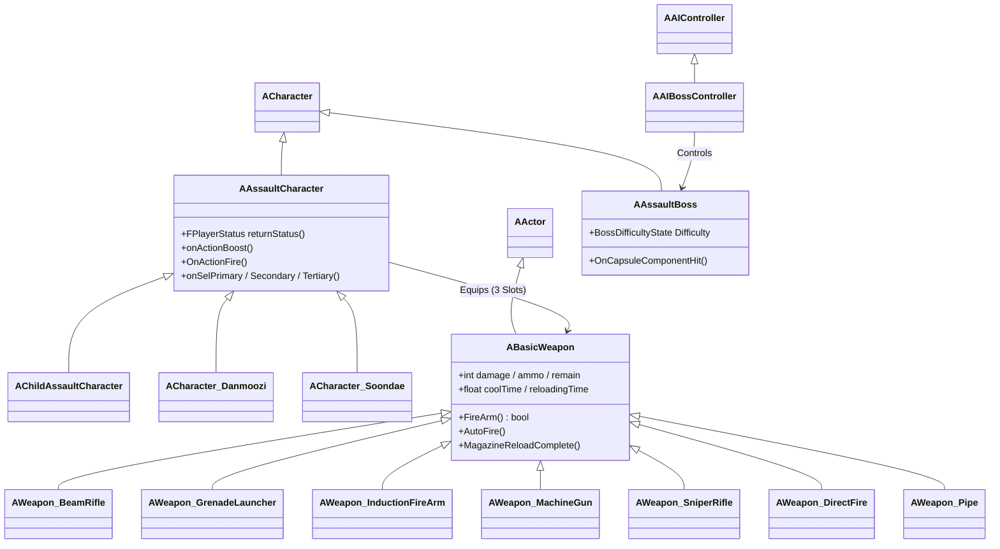

# 🤖 TTAssault (Team TT Project Assault — Unreal Engine 5 C++ 메카닉 슈팅 액션 게임)


-00599C?logo=cplusplus&logoColor=white)


> **다형성 무기·탄환 아키텍처(7종 화기 & 5종 투사체), 부스터 기동 액션, 난이도 상태 기반 AI 보스 전투를 Unreal Engine 5.0 C++ 네이티브 모듈로 구현한 3인칭 메카닉 슈팅 액션 게임**

---

## 1. 목적 및 문제 정의 (Why)

블루프린트(Blueprint) 노드 위주로만 슈팅 액션 게임을 제작할 경우, 탄종별 궤적 계산·연사/재장전/쿨타임 타이머·콤보 판정·네트워크 리플리케이션 속성 관리가 복잡해질수록 유지보수와 성능 최적화가 어려워집니다.

**Team TT (`TTAssault`)** 프로젝트는 핵심 전투 프레임워크 전반을 **Unreal Engine 5 C++ 네이티브 클래스 계층(`Source/TTAssault/`)**으로 설계하여:
1. 공통 무기 인터페이스(`ABasicWeapon`) 확장을 통한 **7종 주/보조/특수 무기의 일관된 탄창·재장전·쿨타임 제어**,
2. **부스터(Booster) 게이지 소모/자동 충전 기동 메커니즘**을 갖춘 메카닉 3인칭 전투 감각 구현,
3. `AIModule`과 연동된 **난이도별(`Easy / Normal / Hard`) AI 보스 캐릭터(`AAssaultBoss`, `AAIBossController`)** 전투 루프를 구현하기 위해 개발되었습니다.

---

## 2. 핵심 기능 및 해결 방식 (What)

1. **부스터 기동 및 3슬롯 무장 플레이어 캐릭터 (`AAssaultCharacter` 및 파생 캐릭터)**
   - 체력(`HP`), 방어력(`Defense`), 부스터 게이지(`booster` / `autoBoosterTimerHandle`), 주무기·보조무기·3번 슬롯 전환(`WeaponSel::Primary / Secondary / Tertiary`) 및 `UnrealNetwork` 리플리케이션 프로퍼티(`GetLifetimeReplicatedProps`) 구조를 갖추고 있습니다.
   - 기본 캐릭터를 상속한 플레이어블 캐릭터 변형(`AChildAssaultCharacter`, `ACharacter_Danmoozi`, `ACharacter_Soondae`)과 전용 애니메이션 인스턴스(`UCharacterAnim`)를 제공합니다.
2. **다형성 무기(`Weapon_*`) 및 탄환(`Bullet_*`) 시스템**
   - 추상 기반 클래스 **`ABasicWeapon`**에서 공격력(`damage`), 발사 쿨타임(`autoFireTimerHandle`), 잔탄 및 재장전(`autoReloadTimerHandle`), 타격 콤보, 폭발 이펙트/사운드를 통합 관리합니다.
   - **구현 화기 7종**: 빔 라이플(`Weapon_BeamRifle`), 직사 화기(`Weapon_DirectFire`), 유탄발사기(`Weapon_GrenadeLauncher`), 유도 화기(`Weapon_InductionFireArm`), 기관총(`Weapon_MachineGun`), 저격소총(`Weapon_SniperRifle`), 근접 파이프(`Weapon_Pipe`)
   - **전용 탄체 5종**: 직사탄(`Bullet_DirectFire`), 빔(`Bullet_BeamRifle`), 포물선 유탄(`Bullet_Grenade`), 유도탄(`Bullet_InductionFire`), 기관총탄(`Bullet_MachineGun`)
3. **난이도 기반 AI 보스 전투 & UMG 인터페이스**
   - `AAssaultBoss`와 `AAIBossController`를 통해 `BossDifficultyState`(`Easy`, `Normal`, `Hard`)에 따른 보스 패턴 및 충돌 판정을 제어합니다.
   - `UGameStartUI` 및 `GameOverUI`(`UMG`)로 시작/종료 흐름과 실시간 탄약·부스터·쿨타임 상태(`FPlayerStatus`) HUD 연동을 지원합니다.

---

## 3. 시스템 아키텍처 및 디렉토리 구조 (How)

### C++ 클래스 상속 및 전투 아키텍처



### 디렉토리 구조

```text
TTAssault/
├── TTAssault.uproject                    # Unreal Engine 5.0 프로젝트 디스크립터 (Engine, AIModule, UMG)
├── Config/                               # 입력 바인딩(DefaultInput.ini), 엔진/게임/태그 환경 설정
├── Source/
│   ├── TTAssault.Target.cs               # 게임 런타임 빌드 타겟
│   ├── TTAssaultEditor.Target.cs         # 에디터 빌드 타겟
│   ├── TTAssaultServer.Target.cs         # 데디케이티드 서버 빌드 타겟
│   └── TTAssault/
│       ├── TTAssault.Build.cs            # Core, Engine, InputCore, UMG, AIModule 의존성 정의
│       ├── Public/                       # C++ 헤더 (.h): 캐릭터, 보스 AI, 7종 무기, 5종 탄환, GameMode, UI
│       └── Private/                      # C++ 구현부 (.cpp): 전투 로직, 탄도 연산, 애니메이션, 보스 제어
└── Content/
    ├── Maps/                             # 전투 스테이지 레벨 (FinalMap.umap, TJMap.umap, THMap.umap)
    ├── Characters/                       # 캐릭터 스켈레탈 메시, 릭 및 애니메이션 에셋
    └── ParagonHowitzer/                  # 메카닉 캐릭터/이펙트 에셋 리소스
```

---

## 4. 로컬 빌드 및 실행 가이드 (Quick Start)

### 사전 요구 사항

- **OS**: Windows 10 / 11 (64-bit)
- **게임 엔진**: **Unreal Engine 5.0** 이상 (Epic Games Launcher 통해 설치)
- **컴파일러 / IDE**: **Visual Studio 2022** (`C++를 사용한 게임 개발` 워크로드 및 Windows 10/11 SDK 포함)

### 설치 및 실행 절차

```powershell
# 1. 저장소 클론 (대용량 에셋 포함 약 3.4GB)
git clone https://github.com/tejo1990/TTAssault.git
cd TTAssault
```

1. 탐색기에서 `TTAssault.uproject` 파일을 우클릭하고 **"Generate Visual Studio project files"**를 실행합니다.
2. 생성된 `TTAssault.sln`을 Visual Studio 2022로 열고 빌드 구성을 **`Development Editor` / `Win64`**로 설정한 뒤 솔루션 빌드(`Ctrl + Shift + B`)를 수행합니다.
3. 빌드가 완료되면 `TTAssault.uproject`를 실행하고 `Content/Maps/FinalMap.umap` 레벨을 열어 에디터 플레이(**PIE**, `Alt + P`)로 게임을 구동합니다.
